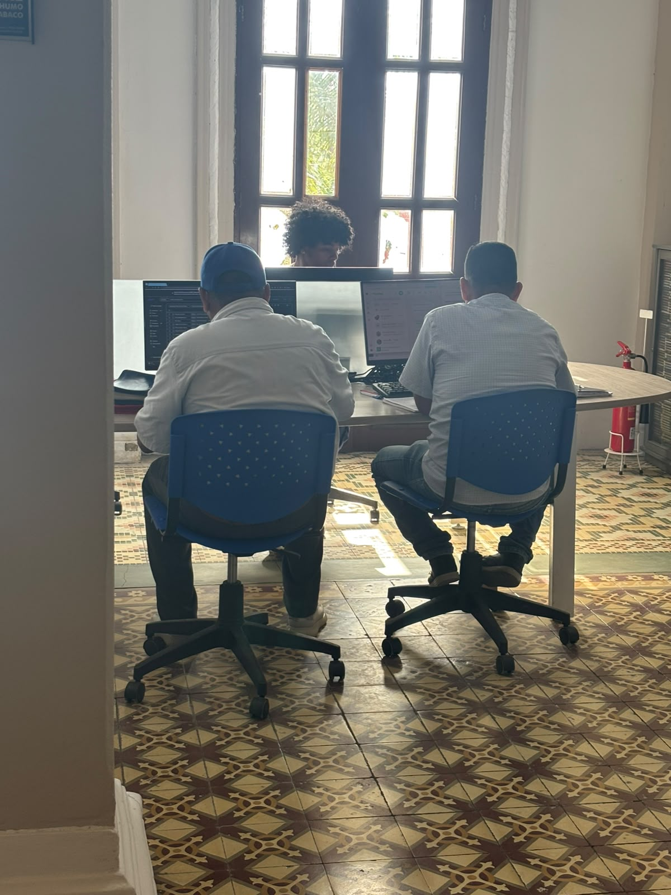
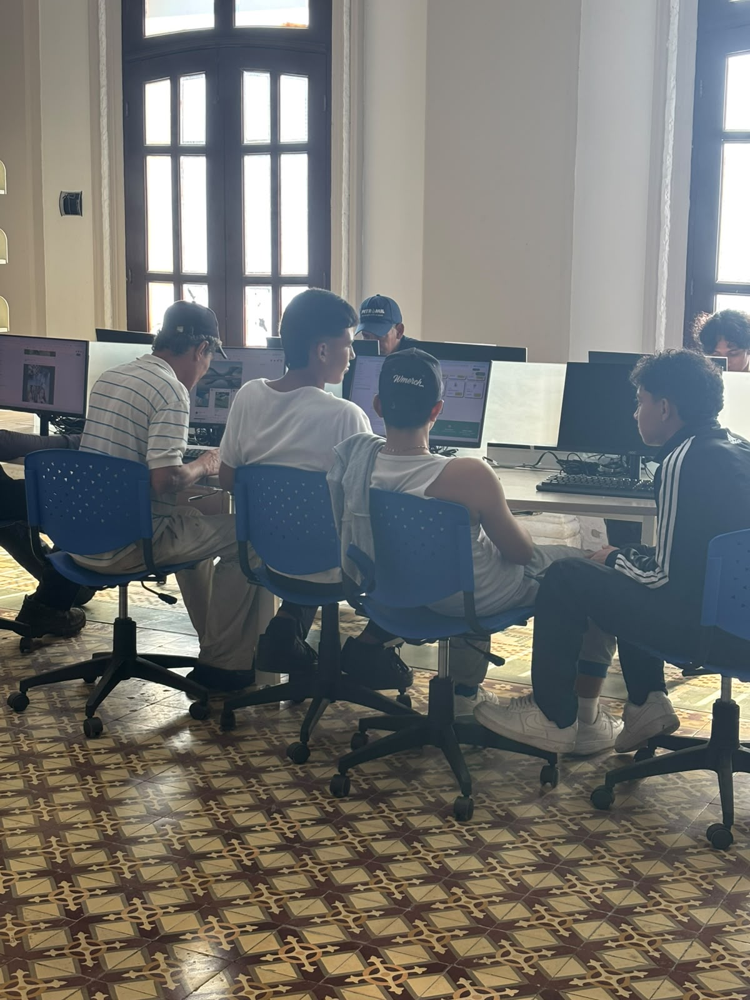
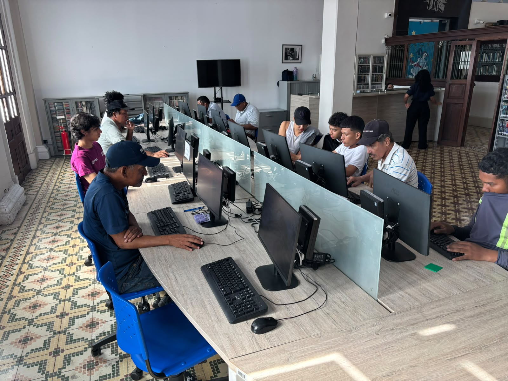
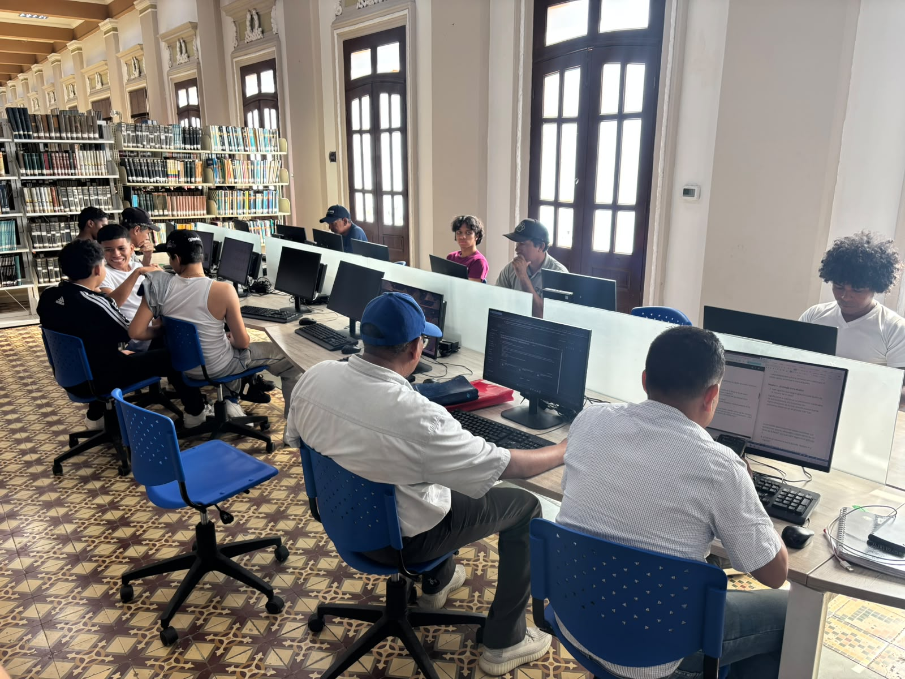

# Usuarios del sistema

Durante nuestra visita a la Sala de Internet del CLENA identificamos varios actores que intervienen en el uso de este espacio. Primero los describimos de forma general y luego los convertimos en personas concretas que nos sirven para diseñar la plataforma pensando en quién la va a usar.

## Tipos de usuario

- **Usuarios directos:** adultos mayores que usan los computadores de la Sala. Son los principales beneficiarios de la propuesta, porque se les dificulta buscar información por su cuenta, saber si un contenido es confiable y reconocer riesgos con sus cuentas y datos personales.
- **Usuarios indirectos:** personas que acompañan a los adultos mayores cuando no logran terminar una actividad digital solos, como familiares o monitores.
- **Responsables del espacio:** personal que administra la Sala, atiende a los usuarios y está pendiente de los equipos.
- **Institución:** el CLENA, que es el entorno donde está la Sala y donde queremos generar un impacto positivo con la propuesta.

## Personas

> Los nombres y datos de estas personas son ficticios. Los construimos a partir de lo que observamos en la visita.

### Persona 1: Don Hernando

- **Edad:** 72 años.
- **Qué hace en el CLENA:** va a la Sala de Internet dos o tres veces por semana a leer noticias y ver videos de música.
- **Relación con la tecnología:** baja. Sabe prender el computador y abrir el navegador, pero se pierde cuando aparece una ventana nueva o un anuncio.
- **Qué le frustra:** tener que pedir que le expliquen lo mismo cada vez que viene, porque de una visita a otra se le olvidan los pasos.
- **Qué necesita lograr:** seguir guías sencillas, con letra grande y paso a paso, que pueda repetir solo y a su propio ritmo.

### Persona 2: Antonio

- **Edad:** 65 años.
- **Qué hace en el CLENA:** usa la Sala para hacer trámites en línea, como pedir citas o descargar certificados.
- **Relación con la tecnología:** media. Maneja WhatsApp y Facebook en el celular, pero no sabe diferenciar una página real de una falsa.
- **Qué le frustra:** le han llegado mensajes sospechosos pidiéndole datos y le da miedo abrir un enlace equivocado o "dañar algo".
- **Qué necesita lograr:** aprender a reconocer engaños y proteger sus cuentas con ejemplos prácticos, y ver cuánto ha avanzado para sentirse más segura.

### Persona 3: Marcela, encargada de la Sala

- **Edad:** 38 años.
- **Qué hace en el CLENA:** abre la Sala, asigna los computadores, resuelve dudas de los usuarios y reporta las fallas de los equipos.
- **Relación con la tecnología:** alta.
- **Qué le frustra:** atiende a muchas personas al mismo tiempo y casi siempre le preguntan lo mismo, así que no le alcanza el tiempo para acompañar con calma a quien más lo necesita.
- **Qué necesita lograr:** tener un lugar donde organizar y publicar guías, recibir las solicitudes de ayuda de forma ordenada y saber qué temas ya dominan los usuarios.

## Evidencia de asistencia al CLENA 

