# Prototipo en Figma

Enlace al prototipo navegable: [Abrir en Figma](https://www.figma.com/design/oBLF7jJv8gcLZ9mn8zJGEO/gestPalette?node-id=58851-109&t=d0PJ2cw2W735h5Xp-1)

Cada pantalla lleva en su nombre el ID de la historia de usuario que cubre. (al ser un prototipo, no está completamente perfecto, pero lleva nuestra idea principal)

## Flujo completo de principio a fin

Inicio → Iniciar sesión → Menú principal → Catálogo de guías → Abrir una guía y descargar el PDF.

---

## Pantallas del estudiante

### US-P1-11 – Inicio
Pantalla de entrada: el usuario elige iniciar sesión, crear una cuenta o entrar como invitado.

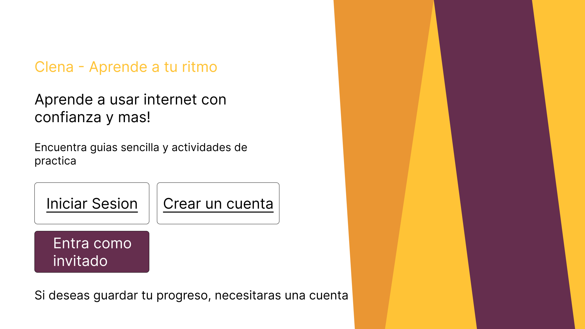

### US-P1-11 – Iniciar sesión
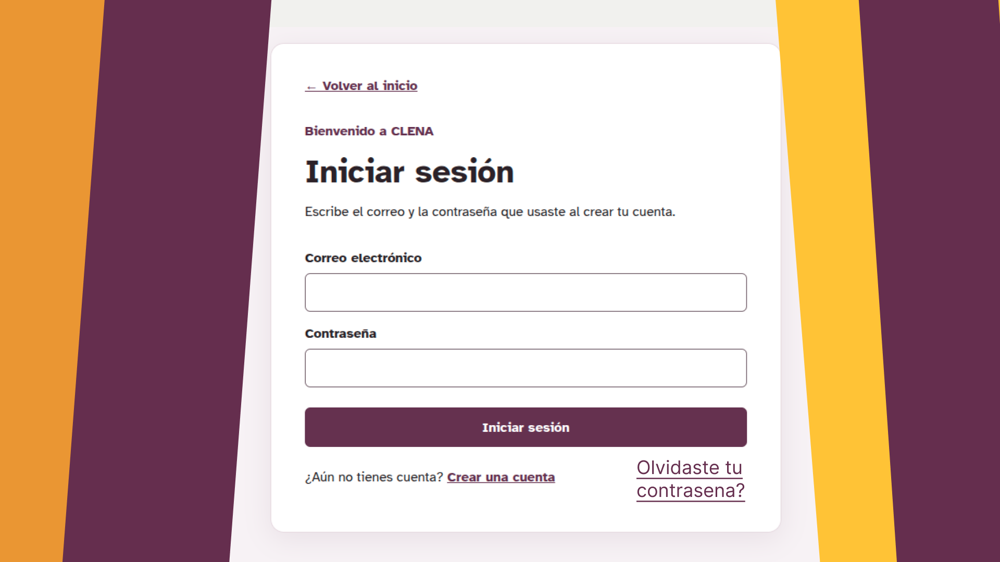

### US-P1-11 – Menú principal
Desde aquí el estudiante accede a guías (US-P1-01), lecciones (US-P1-02), progreso (US-P1-03) y ayuda (US-P1-04).

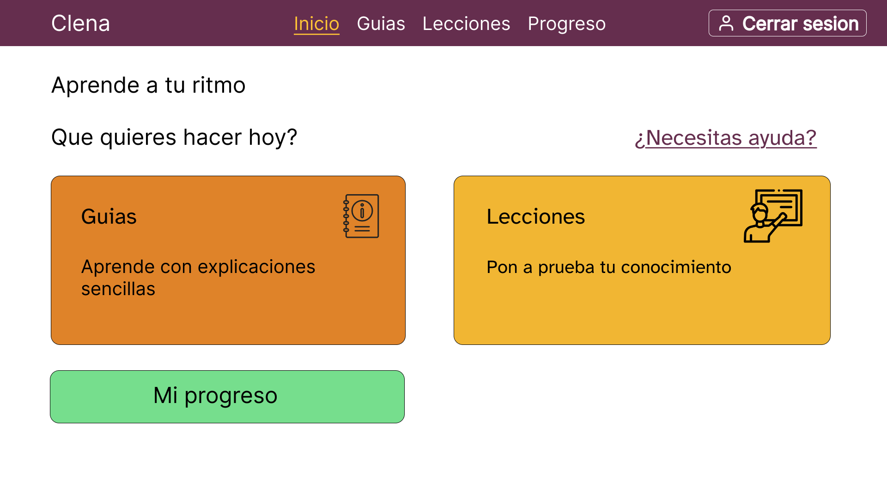

### US-P1-01 – Catálogo de guías
Consultar el catálogo, buscar por nombre y filtrar por categoría.

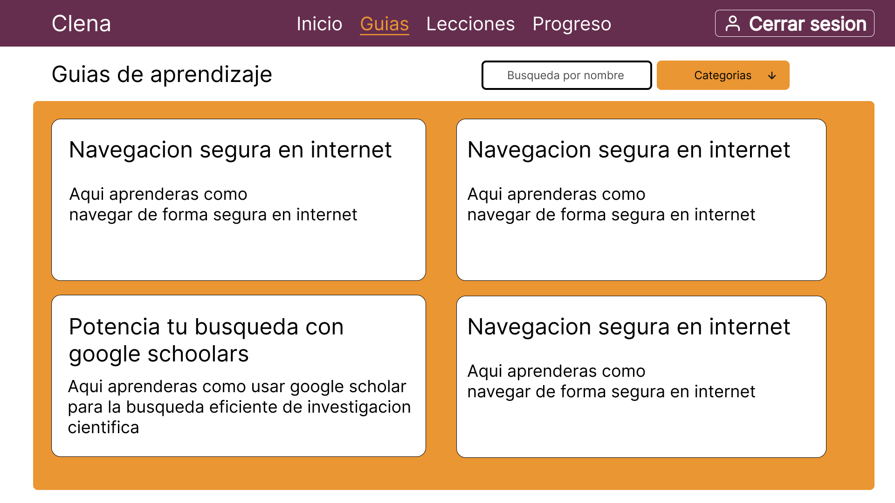

### US-P1-01 – Detalle de la guía
Leer la guía y descargar el PDF.

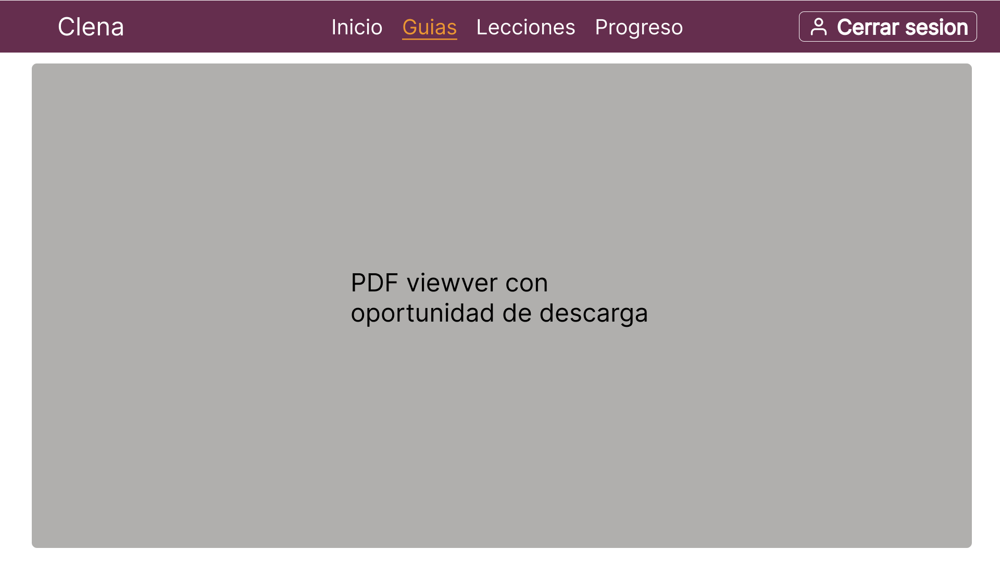

### US-P1-02 – Lecciones
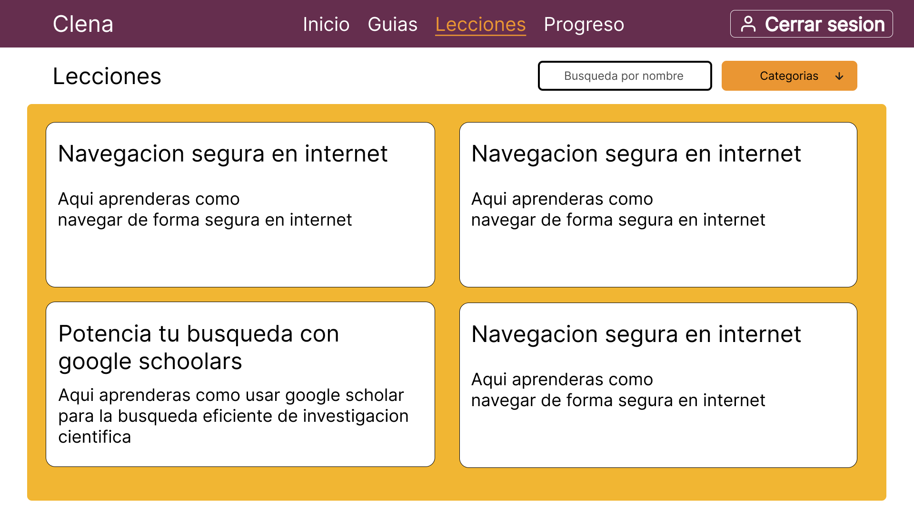

### US-P1-02 – Lección con retroalimentación
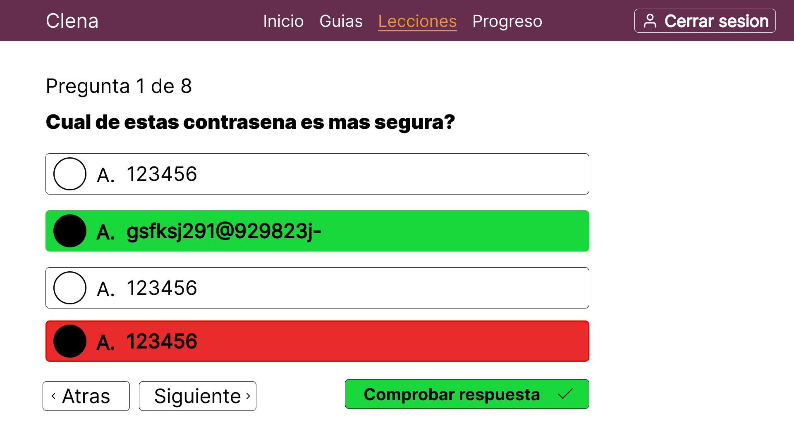

### US-P1-03 – Mi progreso
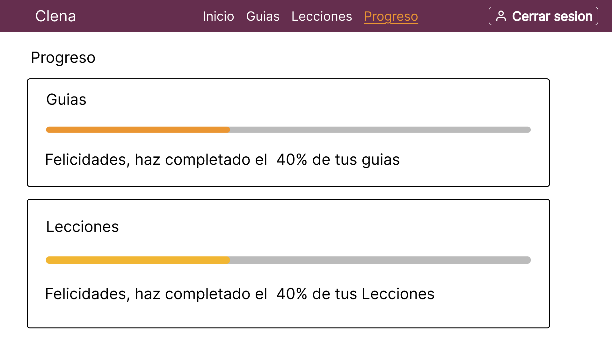

### US-P1-04 – Solicitar ayuda
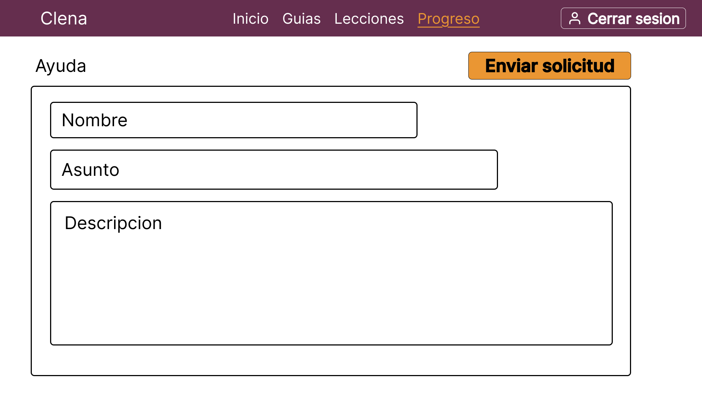

---

## Pantallas del staff

### US-P1-11 – Panel del staff
Desde aquí el staff accede a la gestión de guías y lecciones (US-P1-06), las solicitudes (US-P1-07) y las estadísticas (US-P1-08).

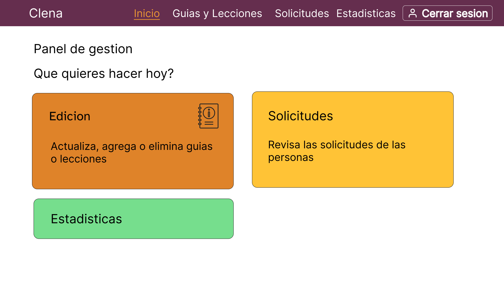

### US-P1-06 – Ver guías
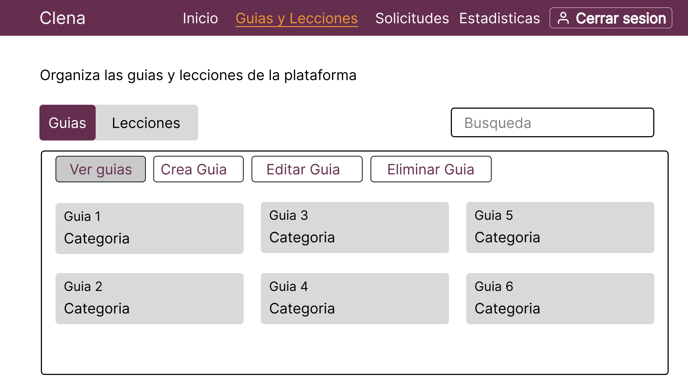

### US-P1-06 – Crear guía
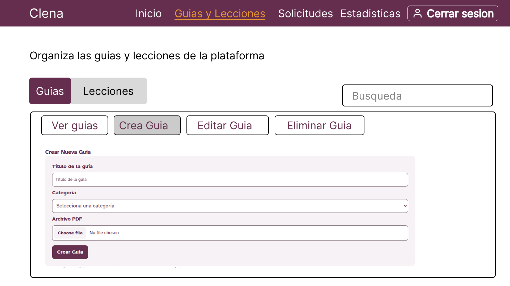

### US-P1-06 – Editar guía
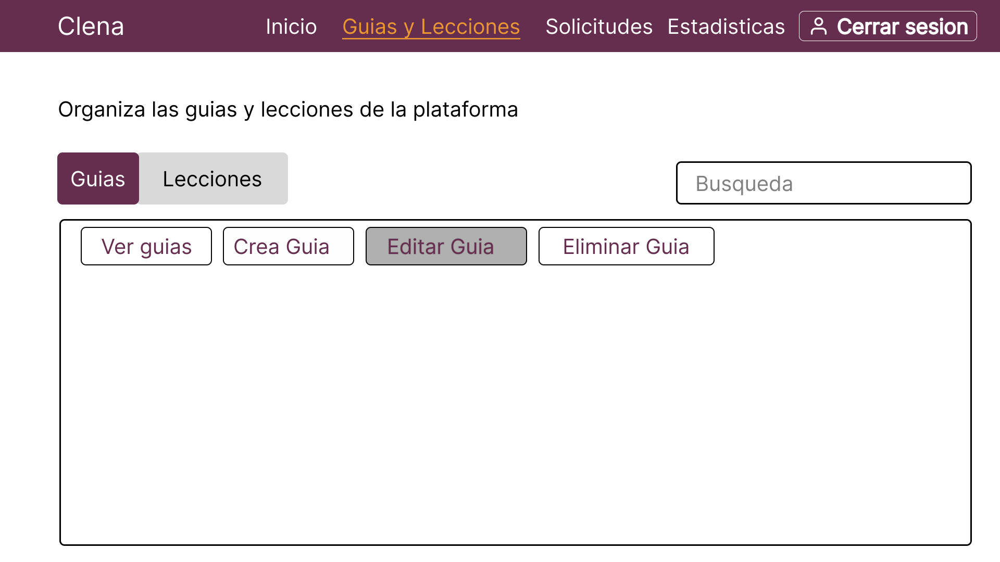

### US-P1-06 – Eliminar guía
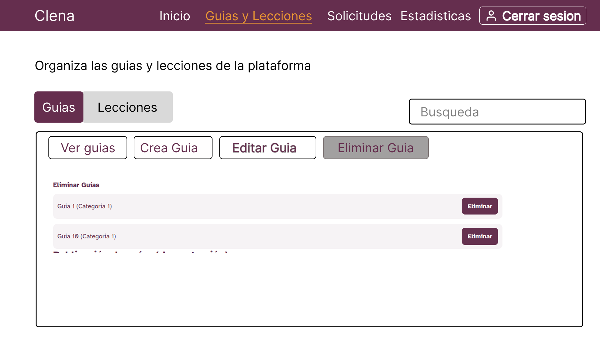

### US-P1-06 – Crear lección
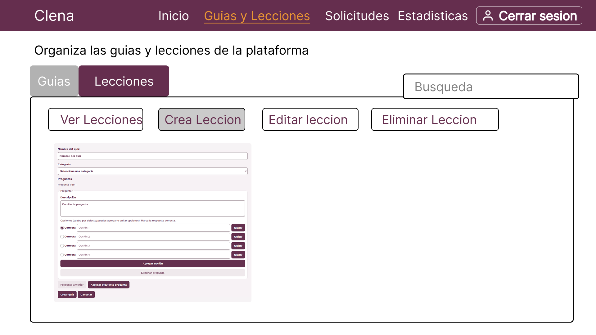

---

## Pantallas del administrador

### US-P1-11 – Panel del administrador
Desde aquí el administrador gestiona las categorías (US-P1-09) y los usuarios (US-P1-10).

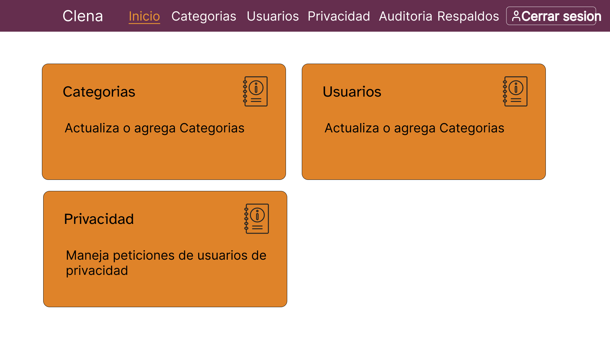
